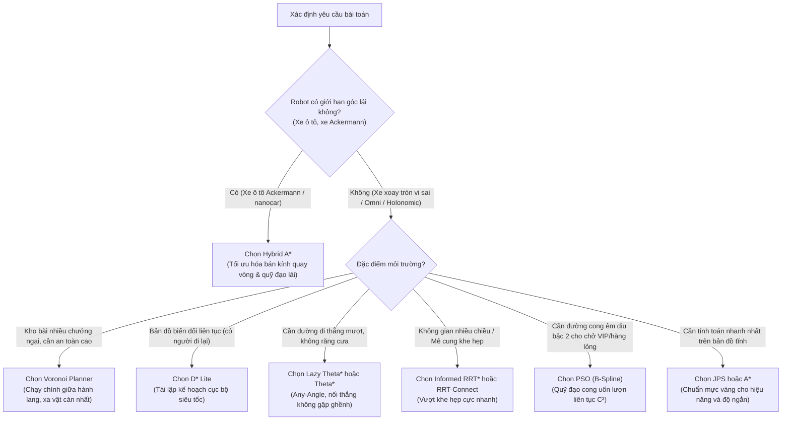

<p align="center">
  
  
  
  
  
</p>

# Phân Tích Chuyên Sâu 20 Thuật Toán Global Planner
### Hệ Thống ROS Motion Planning — Nền Tảng ROS 2 Humble

Tài liệu này cung cấp bản phân tích toàn diện và chi tiết về **20 thuật toán quy hoạch đường đi toàn cục (Global Path Planner)** được tích hợp trong package [`path_planner`](file:///home/picasso/ros2_motion_planning/src/core/path_planner/path_planner).

Tất cả các thuật toán đều kế thừa từ lớp cơ sở [`PathPlanner`](file:///home/picasso/ros2_motion_planning/src/core/path_planner/path_planner/include/path_planner/path_planner.h) và được đóng gói thành Nav2 Global Planner Plugin thông qua [`PathPlannerNode`](file:///home/picasso/ros2_motion_planning/src/core/path_planner/path_planner/include/path_planner/path_planner_node.h).

---

## <span id="contents">Contents</span>

- [1. Nhóm I: Thuật Toán Tìm Kiếm Đồ Thị Ô Lưới (Graph-based Planners)](#1)
  - [1. Dijkstra](#dijkstra)
  - [2. Greedy Best-First Search (GBFS)](#gbfs)
  - [3. A* (A-Star)](#astar)
  - [4. Jump Point Search (JPS)](#jps)
  - [5. Lifelong Planning A* (LPA*)](#lpa_star)
  - [6. D* (Dynamic A*)](#dstar)
  - [7. D* Lite](#dstar_lite)
  - [8. Theta* (Any-Angle A*)](#theta_star)
  - [9. Lazy Theta*](#lazy_theta_star)
  - [10. Strict Theta* (S-Theta*)](#s_theta_star)
  - [11. Voronoi Planner](#voronoi)
  - [12. Hybrid A*](#hybrid_astar)
  - [13. Lazy Planner](#lazy_planner)
- [2. Nhóm II: Thuật Toán Lấy Mẫu Ngẫu Nhiên (Sample-based Planners)](#2)
  - [14. RRT (Rapidly-exploring Random Tree)](#rrt)
  - [15. RRT* (Optimal RRT)](#rrt_star)
  - [16. RRT-Connect](#rrt_connect)
  - [17. Informed RRT*](#informed_rrt_star)
- [3. Nhóm III: Thuật Toán Tiến Hóa & Bầy Đàn (Evolutionary & Swarm Planners)](#3)
  - [18. Particle Swarm Optimization (PSO)](#pso)
  - [19. Genetic Algorithm (GA)](#ga)
  - [20. Ant Colony Optimization (ACO)](#aco)
- [4. Bảng Ma Trận So Sánh Tổng Hợp 20 Thuật Toán](#4)
- [5. Cẩm Nang Chọn Thuật Toán Theo Ứng Dụng Thực Tế](#5)

---

## <span id="1">1. Nhóm I: Thuật Toán Tìm Kiếm Đồ Thị Ô Lưới (Graph-based Planners)</span>

> [!NOTE]
> Tất cả các thuật toán đồ thị trong dự án xuất bản vùng ô lưới đã duyệt qua topic:  
> **Topic:** `/GridBased/expand` | **Type:** `nav_msgs/msg/OccupancyGrid`

---

### <span id="dijkstra">1. Dijkstra</span>

| Thuộc tính | Chi tiết |
| :--- | :--- |
| **Mã nguồn** | [`astar_planner.h`](file:///home/picasso/ros2_motion_planning/src/core/path_planner/path_planner/include/path_planner/graph_planner/astar_planner.h) & [`astar_planner.cpp`](file:///home/picasso/ros2_motion_planning/src/core/path_planner/path_planner/src/graph_planner/astar_planner.cpp) |
| **Cấu hình `user_config.yaml`** | `planner_name: "dijkstra"` (`is_dijkstra_ = true, is_gbfs_ = false`) |
| **Độ phức tạp** | $\mathcal{O}(V \log V + E)$ với cấu trúc Min-Heap |
| **Tính tối ưu** | Tối ưu tuyệt đối trên lưới ô cờ rời rạc |

#### 🔹 Công thức toán học
$$f(n) = g(n)$$

Trong đó:
* $g(n)$: Chi phí thực tế tích lũy từ điểm xuất phát $Start$ đến node hiện tại $n$.
* Không sử dụng hàm ước lượng khoảng cách: $h(n) = 0$.

#### 🔹 Quy trình thực thi
1. Đưa node $Start$ vào hàng đợi ưu tiên `open_list` với chi phí $g(Start) = 0$.
2. Lấy node $n$ có $g(n)$ nhỏ nhất ra khỏi `open_list`, chuyển vào `closed_list`.
3. Duyệt 8 ô lân cận (ngang/dọc có chi phí $1.0$, đường chéo có chi phí $\sqrt{2}$). Nếu tìm thấy đường đến ô lân cận có chi phí $g$ thấp hơn, cập nhật lại $g$ và đưa vào `open_list`.
4. Lặp lại cho đến khi node lấy ra chính là $Goal$.

#### 🔹 Đánh giá
* **Ưu điểm:** Đảm bảo 100% tìm ra đường đi ngắn nhất trên đồ thị ô lưới.
* **Nhược điểm:** Tìm kiếm đẳng hướng (quét lan tỏa tròn/elip đều ra mọi phía), duyệt rất nhiều ô không cần thiết nằm ngược hướng với đích đến.

[▲ Quay lại Mục Lục](#contents)

---

### <span id="gbfs">2. Greedy Best-First Search (GBFS)</span>

| Thuộc tính | Chi tiết |
| :--- | :--- |
| **Mã nguồn** | [`astar_planner.cpp`](file:///home/picasso/ros2_motion_planning/src/core/path_planner/path_planner/src/graph_planner/astar_planner.cpp) |
| **Cấu hình `user_config.yaml`** | `planner_name: "gbfs"` (`is_dijkstra_ = false, is_gbfs_ = true`) |
| **Tính tối ưu** | Không tối ưu (tham lam) |

#### 🔹 Công thức toán học
$$f(n) = h(n)$$

Trong đó:
* $h(n) = \sqrt{(x_n - x_{goal})^2 + (y_n - y_{goal})^2}$ (Khoảng cách Euclidean tới đích).
* Hoàn toàn bỏ qua chi phí đã đi $g(n)$.

#### 🔹 Quy trình thực thi
1. Hàng đợi `open_list` luôn ưu tiên node có khoảng cách ước lượng $h(n)$ gần đích nhất.
2. Thuật toán lao thẳng một mạch về phía đích như một mũi tên dẫn đường.

#### 🔹 Phát triển & Đổi mới so với Dijkstra
* **Đột phá:** Tốc độ tìm kiếm nhanh hơn Dijkstra từ 10 đến 50 lần vì chỉ tập trung mở rộng về hướng mục tiêu, không tốn tài nguyên quét tỏa ra xung quanh.
* **Hạn chế:** Không bảo đảm nghiệm tối ưu. Dễ bị mắc kẹt sâu trong các ngõ cụt dạng chữ U hoặc chướng ngại vật lõm trước khi thoát ra được.

[▲ Quay lại Mục Lục](#contents)

---

### <span id="astar">3. A* (A-Star)</span>

| Thuộc tính | Chi tiết |
| :--- | :--- |
| **Mã nguồn** | [`astar_planner.cpp`](file:///home/picasso/ros2_motion_planning/src/core/path_planner/path_planner/src/graph_planner/astar_planner.cpp) |
| **Cấu hình `user_config.yaml`** | `planner_name: "astar"` (`is_dijkstra_ = false, is_gbfs_ = false`) |
| **Tính tối ưu** | Tối ưu tuyệt đối (nếu $h(n)$ admissible) |

#### 🔹 Công thức toán học
$$f(n) = g(n) + h(n)$$

Trong đó:
* $g(n)$: Chi phí thực tế đã đi từ $Start$ đến $n$.
* $h(n)$: Chi phí ước lượng từ $n$ đến $Goal$ (sử dụng khoảng cách Euclidean). Do $h(n) \le h^*(n)$ (tính Admissible), A* luôn bảo đảm tìm được nghiệm ngắn nhất.

#### 🔹 Phát triển & Đổi mới
* **Phát triển từ Dijkstra & GBFS:** A* kết hợp hoàn hảo ưu điểm của cả hai: vừa hướng về đích nhờ $h(n)$ (như GBFS), vừa không đi chệch khỏi đường tối ưu nhờ $g(n)$ (như Dijkstra).
* Khắc phục vùng quét vô định hình cầu của Dijkstra thành hình elip hẹp hướng thẳng về đích. Đây là chuẩn mực tìm đường tĩnh 2D trong robot học.

[▲ Quay lại Mục Lục](#contents)

---

### <span id="jps">4. Jump Point Search (JPS)</span>

| Thuộc tính | Chi tiết |
| :--- | :--- |
| **Mã nguồn** | [`jps_planner.h`](file:///home/picasso/ros2_motion_planning/src/core/path_planner/path_planner/include/path_planner/graph_planner/jps_planner.h) & [`jps_planner.cpp`](file:///home/picasso/ros2_motion_planning/src/core/path_planner/path_planner/src/graph_planner/jps_planner.cpp) |
| **Cấu hình `user_config.yaml`** | `planner_name: "jps"` |
| **Tính tối ưu** | Tối ưu tuyệt đối trên lưới ô cờ |

#### 🔹 Bản chất & Công thức toán học
Kế thừa hàm đánh giá chi phí của A*:
$$f(n) = g(n) + h(n)$$

#### 🔹 Phát triển & Đột phá cải tiến so với A*
* **Vấn đề của A*:** Trong bản đồ có nhiều khoảng trống (phòng lớn, sân bãi), A* phải đưa hàng ngàn ô trống đối xứng vào `open_list`, gây nghẽn hàng đợi ưu tiên.
* **Đột phá của JPS (Harabor & Grastien 2011):**
  1. **Neighbor Pruning (Cắt tỉa lân cận):** Bỏ qua các ô lân cận mà node cha có thể đi tới trực tiếp với chi phí tương đương hoặc nhỏ hơn mà không cần đi qua node hiện tại.
  2. **Jumping & Forced Neighbors (Điểm nhảy & Lân cận bắt buộc):** Thay vì bước từng ô, JPS "phóng tia nhìn" (jump) thẳng theo hướng đi (ngang/dọc/chéo) cho tới khi chạm vật cản, chạm Goal, hoặc phát hiện một **Forced Neighbor** (ô nằm cạnh góc khuất vật cản).
  3. Chỉ có các **Jump Point** này mới được tạo thành Node và đẩy vào `open_list`.

```cpp
// Trích đoạn xử lý điểm nhảy trong jps_planner.cpp
void JPSPathPlanner::_jump(const JNode& node, OpenList& open_list) {
  int dir = calDir(node.id(), node.pid());
  if (dir == 1 || dir == -1 || dir == nx_ || dir == -nx_) {
    _checkStraightLine(dir, node, open_list);
  } else {
    _checkSlashLine(dir, node, open_list);
  }
}
```

* **Hiệu quả:** Giảm số lượng phần tử cần lưu trong `open_list` từ 90% đến 98% so với A*, tốc độ tăng gấp 5 - 10 lần nhưng vẫn đảm bảo đường đi tối ưu hoàn toàn.

[▲ Quay lại Mục Lục](#contents)

---

### <span id="lpa_star">5. Lifelong Planning A* (LPA*)</span>

| Thuộc tính | Chi tiết |
| :--- | :--- |
| **Mã nguồn** | [`lpa_star_planner.h`](file:///home/picasso/ros2_motion_planning/src/core/path_planner/path_planner/include/path_planner/graph_planner/lpa_star_planner.h) & [`lpa_star_planner.cpp`](file:///home/picasso/ros2_motion_planning/src/core/path_planner/path_planner/src/graph_planner/lpa_star_planner.cpp) |
| **Cấu hình `user_config.yaml`** | `planner_name: "lpa_star"` |
| **Đặc trưng** | Tái lập kế hoạch tăng dần (Incremental Replanning) |

#### 🔹 Công thức toán học
Duy trì 2 giá trị ước lượng chi phí cho mỗi đỉnh $s$:
* $g(s)$: Chi phí đường đi hiện tại.
* $rhs(s)$: Chi phí nhìn trước (One-step lookahead cost):
  $$rhs(s) = \begin{cases} 0, & s = s_{start} \\ \min_{s' \in Pred(s)} \big( g(s') + c(s', s) \big), & \text{otherwise} \end{cases}$$
* Đỉnh $s$ được gọi là **Locally Consistent** khi và chỉ khi $g(s) = rhs(s)$.
* Khóa ưu tiên hai thành phần trong hàng đợi:
  $$\mathbf{k}(s) = \Big[ \min(g(s), rhs(s)) + h(s), \: \min(g(s), rhs(s)) \Big]$$

#### 🔹 Phát triển & Đổi mới so với A*
* **Vấn đề của A*:** Khi bản đồ thay đổi cục bộ (xuất hiện thêm vật cản mới), A* phải xóa bỏ toàn bộ cây tìm kiếm và tính lại từ đầu từ điểm $Start$.
* **Đổi mới của Sven Koenig (2002):** LPA* chỉ đưa những đỉnh bị mất tính nhất quán ($g(s) \neq rhs(s)$) vào hàng đợi để cập nhật lại, tái sử dụng phần lớn cây tìm kiếm đã tính từ lần trước, tiết kiệm tối đa CPU.

[▲ Quay lại Mục Lục](#contents)

---

### <span id="dstar">6. D* (Dynamic A*)</span>

| Thuộc tính | Chi tiết |
| :--- | :--- |
| **Mã nguồn** | [`dstar_planner.h`](file:///home/picasso/ros2_motion_planning/src/core/path_planner/path_planner/include/path_planner/graph_planner/dstar_planner.h) & [`dstar_planner.cpp`](file:///home/picasso/ros2_motion_planning/src/core/path_planner/path_planner/src/graph_planner/dstar_planner.cpp) |
| **Cấu hình `user_config.yaml`** | `planner_name: "dstar"` |
| **Ứng dụng** | Tìm đường động trong môi trường chưa biết |

#### 🔹 Công thức & Trạng thái
* Trạng thái các đỉnh được phân loại qua thẻ tag: `NEW`, `OPEN`, `CLOSED`.
* Lan truyền trạng thái thông qua giá trị khóa $k(X)$ và chi phí $h(X)$:
  * **Trạng thái LOWER** ($k(X) = h(X)$): Chi phí giảm, lan truyền sóng tối ưu.
  * **Trạng thái RAISE** ($k(X) < h(X)$): Chi phí tăng do gặp vật cản mới, lan truyền cảnh báo và tìm đường vòng thay thế.

#### 🔹 Phát triển & Đổi mới
* Thuật toán D* nguyên bản (Anthony Stentz - 1994) là bước đột phá đầu tiên cho phép robot di động vừa di chuyển vừa quét laser: khi gặp vật cản mới chặn đường, D* cập nhật cục bộ ngay lập tức và bẻ lái mà không cần dừng lại tính lại toàn bộ bản đồ.

[▲ Quay lại Mục Lục](#contents)

---

### <span id="dstar_lite">7. D* Lite</span>

| Thuộc tính | Chi tiết |
| :--- | :--- |
| **Mã nguồn** | [`dstar_lite_planner.h`](file:///home/picasso/ros2_motion_planning/src/core/path_planner/path_planner/include/path_planner/graph_planner/dstar_lite_planner.h) & [`dstar_lite_planner.cpp`](file:///home/picasso/ros2_motion_planning/src/core/path_planner/path_planner/src/graph_planner/dstar_lite_planner.cpp) |
| **Cấu hình `user_config.yaml`** | `planner_name: "dstar_lite"` |
| **Độ phức tạp code** | Ngắn gọn và ổn định hơn D* cổ điển |

#### 🔹 Công thức toán học
Kế thừa nền tảng của LPA*, nhưng đảo chiều tìm kiếm từ $Goal$ về vị trí hiện tại của robot $S_{start}$:
$$\mathbf{k}(s) = \Big[ \min(g(s), rhs(s)) + h(S_{start}, s) + k_m, \: \min(g(s), rhs(s)) \Big]$$

Trong đó $k_m$ là hệ số bù dịch chuyển (Key Modifier) tích lũy quãng đường di chuyển của robot:
$$k_m \leftarrow k_m + h(S_{last}, S_{start})$$

#### 🔹 Phát triển & Cải tiến
* **So với D* cổ điển:** D* Lite đạt được cùng hiệu năng và kết quả tối ưu như D* nhưng mã nguồn tinh giản hơn, dễ bảo trì hơn rất nhiều (dựa trên toán học của LPA* thay vì máy trạng thái phức tạp RAISE/LOWER).
* **So với LPA*:** Đảo chiều tìm kiếm từ Goal về Start, giúp robot có thể di chuyển liên tục mà cây đường đi về Goal vẫn giữ nguyên hiệu lực.

[▲ Quay lại Mục Lục](#contents)

---

### <span id="theta_star">8. Theta* (Any-Angle A*)</span>

| Thuộc tính | Chi tiết |
| :--- | :--- |
| **Mã nguồn** | [`theta_star_planner.h`](file:///home/picasso/ros2_motion_planning/src/core/path_planner/path_planner/include/path_planner/graph_planner/theta_star_planner.h) & [`theta_star_planner.cpp`](file:///home/picasso/ros2_motion_planning/src/core/path_planner/path_planner/src/graph_planner/theta_star_planner.cpp) |
| **Cấu hình `user_config.yaml`** | `planner_name: "theta_star"` |
| **Đặc trưng** | Triệt tiêu hoàn toàn góc gấp răng cưa ô lưới |

#### 🔹 Công thức & Nguyên lý (Khái niệm Path 2)
Trong A* chuẩn, node con $s'$ luôn nhận node hiện tại $s$ làm cha:
$$\text{Path 1 (A*): } parent(s') = s, \quad g(s') = g(s) + c(s, s')$$

Trong Theta*, thuật toán kiểm tra đường ngắm thẳng (**Line-of-Sight - LOS**) bằng thuật toán Bresenham giữa $parent(s)$ và $s'$:
* **Nếu $\text{LineOfSight}(parent(s), s') = \text{true}$:**
  $$parent(s') = parent(s), \quad g(s') = g(parent(s)) + \text{dist}(parent(s), s')$$
* **Ngược lại:** Quay về áp dụng Path 1 của A*.

#### 🔹 Phát triển & Đổi mới so với A*
* **Vấn đề của A*:** Quỹ đạo của A* bị giới hạn theo các hướng rời rạc của ô lưới ($0^\circ, 45^\circ, 90^\circ,...$), tạo ra đường đi "răng cưa" thiếu tự nhiên, tốn thêm chiều dài và gây khó khăn cho việc bẻ lái.
* **Đổi mới:** Theta* cho phép đường nối xuyên thẳng qua các ô lưới theo mọi góc tùy ý (Any-Angle) nếu giữa 2 điểm không có vật cản che khuất. Quỹ đạo tạo ra gồm các đoạn thẳng dài, rất mượt.

[▲ Quay lại Mục Lục](#contents)

---

### <span id="lazy_theta_star">9. Lazy Theta*</span>

| Thuộc tính | Chi tiết |
| :--- | :--- |
| **Mã nguồn** | [`lazy_theta_star_planner.h`](file:///home/picasso/ros2_motion_planning/src/core/path_planner/path_planner/include/path_planner/graph_planner/lazy_theta_star_planner.h) & [`lazy_theta_star_planner.cpp`](file:///home/picasso/ros2_motion_planning/src/core/path_planner/path_planner/src/graph_planner/lazy_theta_star_planner.cpp) |
| **Cấu hình `user_config.yaml`** | `planner_name: "lazy_theta_star"` |
| **Tối ưu hóa** | Đánh giá lười (Lazy Evaluation) giảm tải CPU |

#### 🔹 Phát triển & Đổi mới so với Theta*
* **Vấn đề của Theta*:** Việc gọi hàm kiểm tra va chạm Bresenham Line-of-Sight liên tục cho mọi ô lân cận khi mở rộng đỉnh gây tốn rất nhiều tài nguyên tính toán.
* **Đổi mới của Alex Nash (2010):**
  1. Khi duyệt lân cận, thuật toán **giả định lạc quan** rằng luôn có Line-of-Sight và gán tạm $parent(s') = parent(s)$ mà không kiểm tra va chạm ngay.
  2. Chỉ đến khi node $s'$ được lấy ra khỏi `open_list` (trở thành node tốt nhất), thuật toán mới thực sự kiểm tra Line-of-Sight một lần duy nhất.
  3. Nếu kiểm tra va chạm phát hiện bị cản, nó mới lùi về chọn lại $parent(s') = s$ (Path 1).
* **Kết quả:** Giảm số lần kiểm tra va chạm từ 2 đến 5 lần so với Theta* tiêu chuẩn, tăng tốc độ tính toán rõ rệt.

[▲ Quay lại Mục Lục](#contents)

---

### <span id="s_theta_star">10. Strict Theta* (S-Theta*)</span>

| Thuộc tính | Chi tiết |
| :--- | :--- |
| **Mã nguồn** | [`s_theta_star_planner.h`](file:///home/picasso/ros2_motion_planning/src/core/path_planner/path_planner/include/path_planner/graph_planner/s_theta_star_planner.h) & [`s_theta_star_planner.cpp`](file:///home/picasso/ros2_motion_planning/src/core/path_planner/path_planner/src/graph_planner/s_theta_star_planner.cpp) |
| **Cấu hình `user_config.yaml`** | `planner_name: "s_theta_star"` |
| **Độ an toàn** | Bổ sung đệm an toàn tránh cắt góc chướng ngại vật |

#### 🔹 Phát triển & Đổi mới so với Theta*
* **Vấn đề của Theta*:** Vì nối thẳng góc, đường đi Any-Angle của Theta* thường "cắt ngọt" sát mép các góc vuông của chướng ngại vật (Corner Cutting), dễ gây va quẹt thân xe ngoài thực tế.
* **Đổi mới:** S-Theta* siết chặt điều kiện Line-of-Sight bằng cách kiểm tra thêm biên an toàn xung quanh tia ngắm và hạn chế cắt góc nhọn, đảm bảo đường đi luôn cách vật cản một bán kính an toàn tối thiểu.

[▲ Quay lại Mục Lục](#contents)

---

### <span id="voronoi">11. Voronoi Planner</span>

| Thuộc tính | Chi tiết |
| :--- | :--- |
| **Mã nguồn** | [`voronoi_planner.h`](file:///home/picasso/ros2_motion_planning/src/core/path_planner/path_planner/include/path_planner/graph_planner/voronoi_planner.h) & [`voronoi_planner.cpp`](file:///home/picasso/ros2_motion_planning/src/core/path_planner/path_planner/src/graph_planner/voronoi_planner.cpp) |
| **Cấu hình `user_config.yaml`** | `planner_name: "voronoi"` |
| **Mục tiêu** | Tối đa hóa khoảng cách với mọi vật cản (Maximal Clearance) |

#### 🔹 Nguyên lý toán học
* Dựa trên biểu đồ Voronoi suy rộng (**Generalized Voronoi Diagram - GVD**). Mạng lưới Voronoi là tập hợp các điểm trong không gian cách đều ít nhất hai chướng ngại vật gần nhất.
* Sử dụng cấu trúc [`DynamicVoronoi`](file:///home/picasso/ros2_motion_planning/src/core/path_planner/path_planner/include/path_planner/graph_planner/dynamicvoronoi.h) để dựng biểu đồ khoảng cách thời gian thực.

#### 🔹 Cơ chế hoạt động 3 pha
1. **Pha 1:** Tìm đường từ điểm $Start$ đến điểm gần nhất trên "xương sống" Voronoi.
2. **Pha 2:** Robot chạy dọc theo mạng Voronoi (chạy chính giữa các hành lang trống).
3. **Pha 3:** Rời mạng Voronoi để rẽ vào điểm $Goal$.

#### 🔹 So sánh với A*
A* tìm đường ngắn nhất nhưng luôn bám sát mép tường. Voronoi Planner từ bỏ mục tiêu đường ngắn nhất để đạt được **độ an toàn tối đa**, đặc biệt thích hợp cho xe chở hàng giá trị cao trong nhà máy, kho bãi.

[▲ Quay lại Mục Lục](#contents)

---

### <span id="hybrid_astar">12. Hybrid A*</span>

| Thuộc tính | Chi tiết |
| :--- | :--- |
| **Mã nguồn** | [`hybrid_astar_planner.h`](file:///home/picasso/ros2_motion_planning/src/core/path_planner/path_planner/include/path_planner/graph_planner/hybrid_astar_planner/hybrid_astar_planner.h) |
| **Cấu hình `user_config.yaml`** | `planner_name: "hybrid_astar"` |
| **Ràng buộc** | Non-holonomic (Mô hình xe ô tô Ackermann / Dubins) |

#### 🔹 Công thức & Mô hình động học
* Không gian trạng thái 3 chiều liên tục: $s = (x, y, \theta)$.
* Cập nhật trạng thái theo mô hình xe đạp (Bicycle Kinematic Model) với vận tốc $v$, chiều dài cơ sở $L$ và góc bẻ lái $\phi$:
  $$\dot{x} = v \cos\theta, \quad \dot{y} = v \sin\theta, \quad \dot{\theta} = \frac{v}{L} \tan\phi$$
* Hàm Heuristic kết hợp 2 thành phần đối ngẫu:
  $$h(s) = \max \Big( h_{\text{non-holonomic}}(s), \: h_{\text{holonomic}}(s) \Big)$$
  * $h_{\text{non-holonomic}}$: Tính bằng đường cong Dubins / Reeds-Shepp (xét góc lái và bán kính quay tối thiểu, không xét vật cản).
  * $h_{\text{holonomic}}$: Tính bằng 2D Dijkstra/A* (xét vật cản, bỏ qua góc lái).
* **Analytic Expansion:** Khi tiếp cận gần đích, sử dụng đường cong Reeds-Shepp giải tích nối thẳng vào đích trong 1 bước duy nhất.

#### 🔹 Đột phá của Đại học Stanford (DARPA Urban Challenge 2008)
A* truyền thống coi robot là chất điểm không kích thước, có thể quay tại chỗ. Hybrid A* tạo ra quỹ đạo khả thi 100% về mặt động học tay lái cho xe ô tô thực tế (`nanocar`), loại bỏ hoàn toàn hiện tượng bẻ ngoặt gấp bất khả thi.

[▲ Quay lại Mục Lục](#contents)

---

### <span id="lazy_planner">13. Lazy Planner</span>

| Thuộc tính | Chi tiết |
| :--- | :--- |
| **Mã nguồn** | [`lazy_planner.h`](file:///home/picasso/ros2_motion_planning/src/core/path_planner/path_planner/include/path_planner/graph_planner/lazy_planner.h) |
| **Cấu hình `user_config.yaml`** | `planner_name: "lazy"` |
| **Độ phức tạp** | Rất thấp |

#### 🔹 Nguyên lý hoạt động
Nối thẳng đường chim bay từ $Start$ đến $Goal$, kiểm tra va chạm trên đoạn thẳng; nếu có chướng ngại vật thì chèn thêm điểm tránh né trung gian tối thiểu. Thuật toán này phù hợp cho môi trường cực kỳ rộng thoáng, tài nguyên tính toán xấp xỉ bằng 0.

[▲ Quay lại Mục Lục](#contents)

---

## <span id="2">2. Nhóm II: Thuật Toán Lấy Mẫu Ngẫu Nhiên (Sample-based Planners)</span>

> [!NOTE]
> Tất cả thuật toán nhóm này xuất bản cấu trúc cây ngẫu nhiên qua topic:  
> **Topic:** `/GridBased/random_tree` | **Type:** `visualization_msgs/msg/Marker` (Line List màu xanh lá cây)

---

### <span id="rrt">14. RRT (Rapidly-exploring Random Tree)</span>

| Thuộc tính | Chi tiết |
| :--- | :--- |
| **Mã nguồn** | [`rrt_planner.h`](file:///home/picasso/ros2_motion_planning/src/core/path_planner/path_planner/include/path_planner/sample_planner/rrt_planner.h) & [`rrt_planner.cpp`](file:///home/picasso/ros2_motion_planning/src/core/path_planner/path_planner/src/sample_planner/rrt_planner.cpp) |
| **Cấu hình `user_config.yaml`** | `planner_name: "rrt"` |
| **Tính đầy đủ** | Đầy đủ theo xác suất (Probabilistically Complete) |

#### 🔹 Quy trình thuật toán
1. Khởi tạo cây $T$ với gốc là điểm xuất phát $Start$.
2. Lấy mẫu ngẫu nhiên điểm $q_{rand}$ trong không gian cấu hình $\mathcal{C}$ (có xác suất thiên vị hướng về $Goal$).
3. Tìm đỉnh $q_{near} \in T$ gần $q_{rand}$ nhất:
   $$q_{near} = \arg\min_{q \in T} \|q - q_{rand}\|_2$$
4. Mở rộng một bước có độ dài $\Delta q$ (tham số `sample_max_distance`) từ $q_{near}$ về phía $q_{rand}$ để tạo $q_{new}$.
5. Nếu đoạn thẳng $(q_{near}, q_{new})$ không va chạm, thêm $q_{new}$ vào cây $T$ với cha là $q_{near}$.
6. Lặp lại cho đến khi $q_{new}$ tiến vào vùng lân cận của $Goal$.

#### 🔹 Ưu & Nhược điểm
* **Ưu điểm:** Khám phá không gian rất nhanh, không cần rời rạc hóa bản đồ thành ô lưới, hoạt động tốt trong không gian nhiều chiều.
* **Nhược điểm:** Đường đi gồ ghề, không tối ưu do tính chất ngẫu nhiên.

[▲ Quay lại Mục Lục](#contents)

---

### <span id="rrt_star">15. RRT* (Optimal RRT)</span>

| Thuộc tính | Chi tiết |
| :--- | :--- |
| **Mã nguồn** | [`rrt_star_planner.h`](file:///home/picasso/ros2_motion_planning/src/core/path_planner/path_planner/include/path_planner/sample_planner/rrt_star_planner.h) |
| **Cấu hình `user_config.yaml`** | `planner_name: "rrt_star"` |
| **Tính tối ưu** | Tối ưu tiệm cận (Asymptotically Optimal) |

#### 🔹 Phát triển & 2 Đột phá so với RRT (Sertac Karaman & Emilio Frazzoli - MIT 2011)
1. **Choose Best Parent (Chọn cha tối ưu):**  
   Thay vì mặc định lấy $q_{near}$ làm cha, RRT* quét một bán kính lân cận $r$ (`optimization_radius`) xung quanh $q_{new}$ và chọn đỉnh $q_{min}$ sao cho tổng chi phí từ $Start$ qua $q_{min}$ tới $q_{new}$ là nhỏ nhất:
   $$parent(q_{new}) = \arg\min_{q \in X_{near}} \big( \text{cost}(q) + \text{dist}(q, q_{new}) \big)$$
2. **Rewire Tree (Nối lại nhánh cây):**  
   Sau khi thêm $q_{new}$, kiểm tra lại toàn bộ các đỉnh $q_{near}$ trong bán kính $r$. Nếu đi vòng qua $q_{new}$ mang lại chi phí thấp hơn chi phí hiện tại của $q_{near}$:
   * **Nếu $\text{cost}(q_{new}) + \text{dist}(q_{new}, q_{near}) < \text{cost}(q_{near})$:** Cập nhật lại $parent(q_{near}) \leftarrow q_{new}$.

* **Kết quả:** Đạt tính **tối ưu tiệm cận**: chiều dài đường đi liên tục ngắn dần và tiến về nghiệm tối ưu khi số mẫu tăng lên.

[▲ Quay lại Mục Lục](#contents)

---

### <span id="rrt_connect">16. RRT-Connect</span>

| Thuộc tính | Chi tiết |
| :--- | :--- |
| **Mã nguồn** | [`rrt_connect_planner.h`](file:///home/picasso/ros2_motion_planning/src/core/path_planner/path_planner/include/path_planner/sample_planner/rrt_connect_planner.h) |
| **Cấu hình `user_config.yaml`** | `planner_name: "rrt_connect"` |
| **Tốc độ** | Siêu nhanh qua khe hẹp |

#### 🔹 Phát triển & Cải tiến so với RRT
* **Vấn đề của RRT:** Trong mê cung hoặc môi trường có khe hẹp (Narrow Passages), việc phát triển 1 cây từ $Start$ có xác suất trúng khe hẹp rất thấp.
* **Đột phá (Kuffner & LaValle 2000):** Phát triển đồng thời **hai cây tìm kiếm song song**:
  * Cây $T_a$ mọc từ $Start$.
  * Cây $T_b$ mọc từ $Goal$.
* Mỗi vòng lặp, sau khi $T_a$ tạo điểm mới $q_{new}$, cây $T_b$ lập tức mở rộng liên tục nhiều bước (Greedy Extension) về thẳng $q_{new}$. Khi hai cây chạm nhau, đường đi được tạo thành ngay lập tức. Tốc độ nhanh hơn RRT đơn hướng từ 5 đến 20 lần.

[▲ Quay lại Mục Lục](#contents)

---

### <span id="informed_rrt_star">17. Informed RRT*</span>

| Thuộc tính | Chi tiết |
| :--- | :--- |
| **Mã nguồn** | [`informed_rrt_star_planner.h`](file:///home/picasso/ros2_motion_planning/src/core/path_planner/path_planner/include/path_planner/sample_planner/informed_rrt_star_planner.h) |
| **Cấu hình `user_config.yaml`** | `planner_name: "informed_rrt_star"` |
| **Đặc trưng** | Lấy mẫu tập trung trong siêu Elip co dần |

#### 🔹 Công thức toán học
Sau khi tìm thấy đường đi khả thi đầu tiên có chiều dài $c_{best}$, vùng không gian có khả năng cải thiện đường đi nằm gọn bên trong hình siêu Elip nhận $Start$ và $Goal$ làm hai tiêu điểm:
$$\mathcal{X}_{\hat{f}} = \Big\{ x \in \mathcal{C} \;\Big|\; \|x - x_{start}\|_2 + \|x - x_{goal}\|_2 \le c_{best} \Big\}$$

Phương trình Elip có trục lớn $a = c_{best} / 2$ và trục nhỏ $b = \sqrt{c_{best}^2 - c_{min}^2} / 2$, với $c_{min} = \|x_{start} - x_{goal}\|_2$.

#### 🔹 Phát triển & Đổi mới so với RRT* (Jonathan Gammell - 2014)
* **Vấn đề của RRT*:** Sau khi đã tìm thấy đường, RRT* vẫn tiếp tục lấy mẫu ngẫu nhiên đồng đều trên toàn bộ bản đồ. Việc lấy mẫu ở những vùng xa xôi bên ngoài là lãng phí tài nguyên.
* **Đổi mới:** Thay vì lấy mẫu toàn bản đồ, Informed RRT* chỉ lấy mẫu bên trong hình elip. Đường đi càng được tối ưu thì $c_{best}$ càng giảm, hình elip càng co hẹp lại, dồn 100% năng lượng tính toán vào hành lang quanh đường đi để hội tụ về nghiệm tối ưu cực nhanh.

[▲ Quay lại Mục Lục](#contents)

---

## <span id="3">3. Nhóm III: Thuật Toán Tiến Hóa & Bầy Đàn (Evolutionary & Swarm Planners)</span>

> [!NOTE]
> Tất cả các thuật toán nhóm này xuất bản vị trí cá thể/quần thể qua topic:  
> **Topic:** `/GridBased/particles` | **Type:** `visualization_msgs/msg/Marker` (Cube List màu xanh dương)

Trong dự án này, đường đi được tham số hóa thành chuỗi $N$ điểm điều khiển (**Control Points**) của đường cong **B-Spline** bậc cao ([`BSplineCurve`](file:///home/picasso/ros2_motion_planning/src/core/common/include/common/curve/bspline_curve.h)), giúp quỹ đạo luôn đạt độ mượt liên tục bậc hai ($C^2$).

---

### <span id="pso">18. Particle Swarm Optimization (PSO)</span>

| Thuộc tính | Chi tiết |
| :--- | :--- |
| **Mã nguồn** | [`pso_planner.h`](file:///home/picasso/ros2_motion_planning/src/core/path_planner/path_planner/include/path_planner/evolutionary_planner/pso_planner.h) & [`pso_planner.cpp`](file:///home/picasso/ros2_motion_planning/src/core/path_planner/path_planner/src/evolutionary_planner/pso_planner.cpp) |
| **Cấu hình `user_config.yaml`** | `planner_name: "pso"` |
| **Mô phỏng** | Đàn chim / đàn cá tìm mồi |

#### 🔹 Công thức toán học
Mỗi hạt $i$ đại diện cho một đường đi (tập hợp các điểm điều khiển $X_i$). Ở mỗi chu kỳ lặp $t$, vận tốc $V_i$ và tọa độ $X_i$ của hạt được cập nhật theo quy tắc:
$$V_i^{t+1} = w \cdot V_i^t + c_1 r_1 \big( P_{best, i} - X_i^t \big) + c_2 r_2 \big( G_{best} - X_i^t \big)$$
$$X_i^{t+1} = X_i^t + V_i^{t+1}$$

Trong đó:
* $w$: Hệ số quán tính (Inertia Weight).
* $c_1, c_2$: Trọng số học hỏi cá nhân (Cognitive) và xã hội bầy đàn (Social).
* $r_1, r_2 \in [0, 1]$: Các biến ngẫu nhiên.
* $P_{best, i}$: Vị trí tốt nhất mà riêng hạt $i$ từng đạt được.
* $G_{best}$: Vị trí tốt nhất mà toàn thể bầy đàn từng ghi nhận.

#### 🔹 Hàm thích nghi (Fitness Function)
Hàm mục tiêu tích hợp đa tiêu chí: tối thiểu hóa chiều dài B-spline, tối đa hóa khoảng cách với vật cản và giới hạn độ cong (Curvature) để xe vào cua êm dịu.

[▲ Quay lại Mục Lục](#contents)

---

### <span id="ga">19. Genetic Algorithm (GA)</span>

| Thuộc tính | Chi tiết |
| :--- | :--- |
| **Mã nguồn** | [`ga_planner.h`](file:///home/picasso/ros2_motion_planning/src/core/path_planner/path_planner/include/path_planner/evolutionary_planner/ga_planner.h) & [`ga_planner.cpp`](file:///home/picasso/ros2_motion_planning/src/core/path_planner/path_planner/src/evolutionary_planner/ga_planner.cpp) |
| **Cấu hình `user_config.yaml`** | `planner_name: "ga"` |
| **Mô phỏng** | Chọn lọc tự nhiên và di truyền học Darwin |

#### 🔹 Quy trình tiến hóa
1. **Nhiễm sắc thể (Chromosome):** Vector chứa chuỗi tọa độ các điểm điều khiển B-Spline.
2. **Đánh giá thích nghi (Fitness Evaluation):** Tính toán độ dài đường đi và mức độ an toàn không va quẹt.
3. **Chọn lọc (Selection):** Sử dụng cơ chế Bánh xe Roulette hoặc Chọn lọc tinh hoa (Elitism) để chọn các cá thể tốt nhất giữ lại làm cha mẹ.
4. **Lai ghép (Crossover):** Ghép chéo các đoạn điểm điều khiển giữa hai cá thể cha mẹ để sinh ra đường đi con kế thừa ưu điểm của cả hai.
5. **Đột biến (Mutation):** Với xác suất nhỏ, dịch chuyển ngẫu nhiên tọa độ một số điểm điều khiển để thoát khỏi các nghiệm cực tiểu cục bộ.

[▲ Quay lại Mục Lục](#contents)

---

### <span id="aco">20. Ant Colony Optimization (ACO)</span>

| Thuộc tính | Chi tiết |
| :--- | :--- |
| **Mã nguồn** | [`aco_planner.h`](file:///home/picasso/ros2_motion_planning/src/core/path_planner/path_planner/include/path_planner/evolutionary_planner/aco_planner.h) & [`aco_planner.cpp`](file:///home/picasso/ros2_motion_planning/src/core/path_planner/path_planner/src/evolutionary_planner/aco_planner.cpp) |
| **Cấu hình `user_config.yaml`** | `planner_name: "aco"` |
| **Mô phỏng** | Vết mùi Pheromone của bầy kiến |

#### 🔹 Công thức toán học
Xác suất một con kiến chọn di chuyển từ điểm $i$ sang điểm $j$ trong danh sách hợp lệ:
$$P_{ij} = \frac{[\tau_{ij}]^\alpha \cdot [\eta_{ij}]^\beta}{\sum_{k \in \text{allowed}} [\tau_{ik}]^\alpha \cdot [\eta_{ik}]^\beta}$$

Trong đó:
* $\tau_{ij}$: Nồng độ pheromone tích lũy trên cạnh nối $(i, j)$.
* $\eta_{ij} = \frac{1}{d_{ij}}$: Độ hấp dẫn Heuristic (nghịch đảo khoảng cách đến đích).
* $\alpha, \beta$: Trọng số điều tiết ảnh hưởng của mùi pheromone và khoảng cách.

Cơ chế bay hơi và bồi đắp mùi pheromone sau mỗi chu kỳ:
$$\tau_{ij} \leftarrow (1 - \rho)\tau_{ij} + \Delta \tau_{ij}$$

Đoạn đường nào ngắn hơn và an toàn hơn sẽ có lượng kiến qua lại nhiều hơn, nồng độ pheromone tăng nhanh hơn, dẫn dắt toàn bộ đàn kiến hội tụ về tuyến đường tối ưu.

[▲ Quay lại Mục Lục](#contents)

---

## <span id="4">4. Bảng Ma Trận So Sánh Tổng Hợp 20 Thuật Toán</span>

| Thuật Toán | Nhóm | Tính Tối Ưu | Độ Mượt Quỹ Đạo | Tốc Độ Tính Toán | Ràng Buộc Góc Lái (Non-holonomic) | Topic RViz2 |
| :--- | :--- | :--- | :--- | :--- | :---: | :--- |
| **Dijkstra** | Graph | Tối ưu ô cờ | Thấp (Răng cưa) | Chậm | ❌ Không | `/GridBased/expand` |
| **GBFS** | Graph | Không tối ưu | Thấp | Rất nhanh | ❌ Không | `/GridBased/expand` |
| **A\*** | Graph | Tối ưu ô cờ | Thấp (Răng cưa) | Nhanh | ❌ Không | `/GridBased/expand` |
| **JPS** | Graph | Tối ưu ô cờ | Thấp (Răng cưa) | Cực nhanh | ❌ Không | `/GridBased/expand` |
| **LPA\*** | Incremental | Tối ưu tái lập | Thấp | Cực nhanh (khi sửa đổi) | ❌ Không | `/GridBased/expand` |
| **D\*** | Incremental | Tối ưu tái lập | Thấp | Nhanh | ❌ Không | `/GridBased/expand` |
| **D\* Lite** | Incremental | Tối ưu tái lập | Thấp | Cực nhanh | ❌ Không | `/GridBased/expand` |
| **Theta\*** | Any-Angle | Gần tối ưu | Rất cao (Đoạn thẳng) | Trung bình | ❌ Không | `/GridBased/expand` |
| **Lazy Theta\*** | Any-Angle | Gần tối ưu | Rất cao (Đoạn thẳng) | Nhanh | ❌ Không | `/GridBased/expand` |
| **S-Theta\*** | Any-Angle | Gần tối ưu | Rất cao (Có đệm) | Trung bình | ❌ Không | `/GridBased/expand` |
| **Voronoi** | Graph | Xa vật cản nhất | Trung bình | Nhanh | ❌ Không | `/GridBased/expand` |
| **Hybrid A\*** | Kinematic | Tối ưu động học | Cực cao (Đường lái) | Trung bình / Chậm | **✅ Có (Ackermann / Dubins)** | `/GridBased/expand` |
| **Lazy** | Graph | Thô | Trung bình | Rất nhanh | ❌ Không | `/GridBased/expand` |
| **RRT** | Sample | Kém | Kém | Nhanh | ❌ Không | `/GridBased/random_tree` |
| **RRT\*** | Sample | Tiệm cận tối ưu | Khá | Trung bình | ❌ Không | `/GridBased/random_tree` |
| **RRT-Connect** | Sample | Kém | Kém | Siêu nhanh | ❌ Không | `/GridBased/random_tree` |
| **Informed RRT\*** | Sample | Tiệm cận tối ưu | Tốt | Nhanh | ❌ Không | `/GridBased/random_tree` |
| **PSO** | Swarm | Gần tối ưu | Tuyệt đối (B-Spline) | Trung bình | Gián tiếp (qua độ cong) | `/GridBased/particles` |
| **GA** | Evolutionary | Gần tối ưu | Tuyệt đối (B-Spline) | Chậm | Gián tiếp (qua độ cong) | `/GridBased/particles` |
| **ACO** | Swarm | Gần tối ưu | Tuyệt đối (B-Spline) | Chậm | Gián tiếp (qua độ cong) | `/GridBased/particles` |

[▲ Quay lại Mục Lục](#contents)

---

## <span id="5">5. Cẩm Nang Chọn Thuật Toán Theo Ứng Dụng Thực Tế</span>

> [!TIP]
> Việc lựa chọn thuật toán phù hợp phụ thuộc vào kiểu chuyển động của robot và tính chất của môi trường làm việc:



[▲ Quay lại Mục Lục](#contents)
