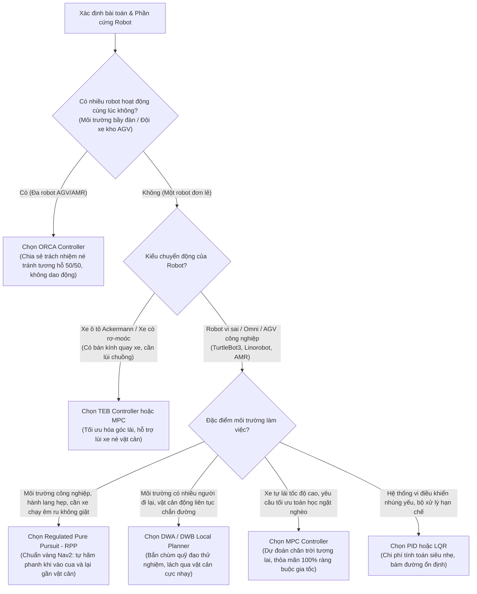

  
  
  
  
  

# Phân Tích Chuyên Sâu Các Thuật Toán Local Planner / Controller
### Hệ Thống ROS Motion Planning — Nền Tảng ROS 2 Humble

Tài liệu này phân tích chi tiết toàn bộ các **thuật toán lập kế hoạch đường đi cục bộ & điều khiển bám quỹ đạo (Local Path Planner / Controller)** có trong hệ thống, nằm tại thư mục [`src/core/controller`](file:///home/picasso/ros2_motion_planning/src/core/controller) và được tích hợp trong ngăn xếp Nav2 thông qua node `controller_server`.

Trong hệ thống điều hướng tự hành, **Local Planner (Controller)** đảm nhận nhiệm vụ cốt tử: tiếp nhận đường đi toàn cục (Global Plan) thô, tính toán vận tốc động học thời gian thực ($v, \omega$), vừa bám sát quỹ đạo vừa phát hiện và né tránh linh hoạt các chướng ngại vật động bất ngờ xuất hiện trên Local Costmap.

---

## Contents

- [1. Nhóm I: Thuật Toán Điều Khiển Hình Học & Bám Sai Số (Geometric & Error-based)](#1)
  - [1. PID Controller](#pid)
  - [2. Pure Pursuit & Regulated Pure Pursuit (RPP)](#rpp)
  - [3. Artificial Potential Field (APF)](#apf)
- [2. Nhóm II: Thuật Toán Điều Khiển Tối Ưu Hiện Đại (Optimal & Predictive Control)](#2)
  - [4. Linear Quadratic Regulator (LQR)](#lqr)
  - [5. Model Predictive Control (MPC)](#mpc)
- [3. Nhóm III: Thuật Toán Lấy Mẫu Không Gian Vận Tốc & Quỹ Đạo (Velocity & Trajectory Rollout)](#3)
  - [6. Dynamic Window Approach (DWA) & DWB (Nav2)](#dwa)
  - [7. Timed Elastic Band (TEB)](#teb)
  - [8. State Lattice Planner](#lattice)
- [4. Nhóm IV: Thuật Toán Đa Robot & Tránh Va Chạm Tương Hỗ (Multi-Agent & Reciprocal Avoidance)](#4)
  - [9. Optimal Reciprocal Collision Avoidance (ORCA)](#orca)
  - [10. Static Controller](#static)
- [5. Bảng Ma Trận So Sánh Tổng Hợp Các Local Planner](#5)
- [6. Cẩm Nang Chọn Local Planner Theo Ứng Dụng Thực Tế](#6)

---

## 1. Nhóm I: Thuật Toán Điều Khiển Hình Học & Bám Sai Số (Geometric & Error-based)

> [!NOTE]
> Nhóm thuật toán này tập trung bám chính xác quỹ đạo hình học thông qua các điểm ngắm trước (**Lookahead Point**).  
> **Topic Marker trực quan:** `/target_point` (`visualization_msgs/msg/Marker` - Sphere màu đỏ) | **Vị trí robot:** `/current_pose`

---

### 1. PID Controller

| Thuộc tính | Chi tiết |
| :--- | :--- |
| **Mã nguồn** | [`pid_controller.h`](file:///home/picasso/ros2_motion_planning/src/core/controller/pid_controller/include/controller/pid_controller.h) & [`pid_controller.cpp`](file:///home/picasso/ros2_motion_planning/src/core/controller/pid_controller/src/pid_controller.cpp) |
| **Cấu hình `user_config.yaml`** | `robot1_local_planner: "pid"` |
| **Kiểu điều khiển** | Phản hồi sai số kín (Closed-loop feedback) |
| **Topic Marker** | `/target_point` (Điểm ngắm Lookahead) |

#### 🔹 Công thức toán học
Bộ điều khiển PID tính toán tín hiệu điều khiển vận tốc dựa trên sai số giữa trạng thái mong muốn $\mathbf{s}_d = [x_d, y_d, \theta_d]^T$ và trạng thái hiện tại $\mathbf{s} = [x, y, \theta]^T$:

$$\mathbf{e}(t) = \mathbf{s}_d(t) - \mathbf{s}(t) = \begin{bmatrix} e_x(t) \\ e_y(t) \\ e_\theta(t) \end{bmatrix}$$

Khoảng cách ngắm trước thích nghi theo vận tốc hiện tại:
$$L = \text{clamp}\big( |v_t| \cdot T_{\text{lookahead}}, \: L_{\min}, \: L_{\max} \big)$$

Tín hiệu điều khiển gồm 3 thành phần:
* **Tỷ lệ (P):** Phản ứng trực tiếp với độ lớn sai số hiện tại.
* **Tích phân (I):** Triệt tiêu sai số xác lập tích lũy qua thời gian.
* **Vi phân (D):** Dự đoán tốc độ biến thiên sai số để hãm đà, chống vọt lố.

$$u_v(t) = K_{p,v} e_v(t) + K_{i,v} \int_0^t e_v(\tau) d\tau + K_{d,v} \frac{d e_v(t)}{dt}$$
$$u_\omega(t) = K_{p,\omega} e_\theta(t) + K_{i,\omega} \int_0^t e_\theta(\tau) d\tau + K_{d,\omega} \frac{d e_\theta(t)}{dt}$$

Trong project, hỗ trợ 2 chế độ:
1. **Model-free PID:** Điều khiển thuần hình học không phụ thuộc mô hình xe.
2. **Model-based PID:** Bổ sung mô hình động học xe vi sai giải tích để bù trượt góc.

#### 🔹 Ưu & Nhược điểm
* **Ưu điểm:** Cấu trúc cực kỳ đơn giản, thời gian tính toán siêu tốc ($< 0.1\text{ ms}$), dễ tinh chỉnh cho các robot đơn giản.
* **Nhược điểm:** Hoàn toàn "mù" trước vật cản động (không có cơ chế né vật cản độc lập, phụ thuộc 100% vào Global Planner), dễ dao động lắc quanh đường đi nếu hệ số $K_p, K_d$ chưa được tối ưu.

[▲ Quay lại Mục Lục](#contents)

---

### 2. Pure Pursuit & Regulated Pure Pursuit (RPP)

| Thuộc tính | Chi tiết |
| :--- | :--- |
| **Mã nguồn** | [`rpp_controller.h`](file:///home/picasso/ros2_motion_planning/src/core/controller/rpp_controller/include/controller/rpp_controller.h) & [`rpp_controller.cpp`](file:///home/picasso/ros2_motion_planning/src/core/controller/rpp_controller/src/rpp_controller.cpp) |
| **Cấu hình `user_config.yaml`** | `robot1_local_planner: "rpp"` |
| **Đặc trưng** | Thuật toán bám đường chuẩn công nghiệp của Nav2 ROS 2 |
| **Topic Marker** | `/target_point` (Lookahead Point màu đỏ) |

#### 🔹 Nguyên lý Pure Pursuit cổ điển
Pure Pursuit (Coulter 1992) xem chuyển động từ vị trí robot đến điểm ngắm trước $L$ như một cung tròn tiếp xúc với hướng hiện tại của xe. Bán kính cong $\kappa$ được xác định qua góc lệch $\alpha$:

$$\kappa = \frac{2 \sin\alpha}{L}, \qquad \omega = v \cdot \kappa$$

#### 🔹 Đột phá của Regulated Pure Pursuit (Steve Macenski - Nav2 2023)
Pure Pursuit truyền thống thường phóng xe hết tốc lực qua các khúc cua gắt, dẫn đến lật xe hoặc trượt bánh ra ngoài quỹ đạo. RPP giải quyết triệt để bằng **4 bộ điều hòa vận tốc thông minh (Velocity Regulators)**:

1. **Điều hòa theo độ cong (Curvature Regulation):**  
   Khi ôm cua có bán kính cong $r = \frac{1}{|\kappa|} < r_{\min}$, vận tốc dài tự động hạ thấp tương ứng:
   $$v_{\text{curv}} = v_{\max} \cdot \frac{r}{r_{\min}}$$

2. **Điều hòa theo khoảng cách vật cản (Obstacle Proximity Regulation):**  
   Càng tiến gần chướng ngại vật trên Costmap, xe càng tự động rà phanh đi chậm lại:
   $$v_{\text{cost}} = v_{\max} \cdot \left( \frac{\text{cost}_{\text{lethal}} - \text{cost}_{\text{current}}}{\text{cost}_{\text{lethal}} - \text{cost}_{\text{free}}} \right)$$

3. **Điều hòa khi tiếp cận đích (Approach Deceleration):**  
   Tạo biên phanh giảm tốc mượt mà khi đến gần điểm đến, tránh giật khựng xe.

4. **Quay tại chỗ ở góc gắt (Rotate-in-place at sharp turns):**  
   Nếu góc lệch hướng $|\alpha| > \frac{\pi}{2}$, robot dừng hẳn chuyển động tịnh tiến ($v = 0$) để quay xoay hướng tại chỗ trước, khi góc lệch đã nhỏ mới bắt đầu tăng tốc tịnh tiến.

[▲ Quay lại Mục Lục](#contents)

---

### 3. Artificial Potential Field (APF)

| Thuộc tính | Chi tiết |
| :--- | :--- |
| **Mã nguồn** | [`apf_controller.h`](file:///home/picasso/ros2_motion_planning/src/core/controller/apf_controller/include/controller/apf_controller.h) & [`apf_controller.cpp`](file:///home/picasso/ros2_motion_planning/src/core/controller/apf_controller/src/apf_controller.cpp) |
| **Cấu hình `user_config.yaml`** | `robot1_local_planner: "apf"` |
| **Ý tưởng** | Mô phỏng trường thế lực hấp dẫn & lực đẩy vật lý |
| **Topic Marker** | `/target_point` |

#### 🔹 Công thức toán học
Robot di chuyển trong không gian thế năng nhân tạo:
$$U(\mathbf{q}) = U_{\text{att}}(\mathbf{q}) + U_{\text{rep}}(\mathbf{q})$$

1. **Thế năng hấp dẫn (Attractive Potential):** Kéo robot về điểm ngắm đích:
   $$\mathbf{F}_{\text{att}}(\mathbf{q}) = -\nabla U_{\text{att}}(\mathbf{q}) = \xi \cdot \frac{\mathbf{q}_{\text{target}} - \mathbf{q}}{\|\mathbf{q}_{\text{target}} - \mathbf{q}\|}$$

2. **Thế năng đẩy (Repulsive Potential):** Đẩy robot ra xa các chướng ngại vật. Trong dự án, lực đẩy được tính trực tiếp từ gradient của mảng ô nhớ Costmap:
   $$\mathbf{F}_{\text{rep}}(\mathbf{q}) = -\nabla U_{\text{rep}}(\mathbf{q}) = k \cdot \nabla \text{Cost}(mx, my)$$
   Trong đó $k = \frac{1 - \frac{1}{dist}}{dist^2}$ với khoảng cách chuẩn hóa từ giá trị ô cản.

3. **Hợp lực điều khiển:**
   $$\mathbf{F}_{\text{total}} = \mathbf{F}_{\text{att}} + \mathbf{F}_{\text{rep}}$$
   Độ lớn hợp lực quy đổi thành vận tốc tịnh tiến $v$, góc của hợp lực so với hướng xe quy đổi thành vận tốc góc $\omega$.

#### 🔹 Đánh giá
* **Ưu điểm:** Khả năng né vật cản động xuất hiện bất ngờ tức thì mà không cần tính toán quỹ đạo mô phỏng phức tạp.
* **Nhược điểm:** Dễ rơi vào bẫy cực tiểu cục bộ (Local Minima) hoặc hiện tượng dao động lắc lư khi lực hút và lực đẩy triệt tiêu nhau ở khe hẹp đối xứng.

[▲ Quay lại Mục Lục](#contents)

---

## 2. Nhóm II: Thuật Toán Điều Khiển Tối Ưu Hiện Đại (Optimal & Predictive Control)

> [!NOTE]
> Nhóm thuật toán này dựa trên lý thuyết điều khiển tối ưu hiện đại, thiết lập mô hình động học trạng thái và giải bài toán tối ưu hàm mục tiêu theo thời gian.

---

### 4. Linear Quadratic Regulator (LQR)

| Thuộc tính | Chi tiết |
| :--- | :--- |
| **Mã nguồn** | [`lqr_controller.h`](file:///home/picasso/ros2_motion_planning/src/core/controller/lqr_controller/include/controller/lqr_controller.h) & [`lqr_controller.cpp`](file:///home/picasso/ros2_motion_planning/src/core/controller/lqr_controller/src/lqr_controller.cpp) |
| **Cấu hình `user_config.yaml`** | `robot1_local_planner: "lqr"` |
| **Đặc trưng** | Tối ưu hóa hàm chi phí toàn phương vô hạn |
| **Topic Marker** | `/target_point` |

#### 🔹 Phương trình trạng thái sai số tuyến tính hóa
Xét vector trạng thái sai số $\mathbf{e} = [e_x, e_y, e_\theta]^T$ giữa robot và điểm tham chiếu. Phương trình trạng thái sai số rời rạc:

$$\mathbf{e}_{k+1} = \mathbf{A} \mathbf{e}_k + \mathbf{B} \Delta \mathbf{u}_k$$

Với các ma trận hệ thống được tuyến tính hóa quanh điểm làm việc:
$$\mathbf{A} = \begin{bmatrix} 1 & 0 & -u_{r,v} \sin(\theta_d) \Delta t \\ 0 & 1 & u_{r,v} \cos(\theta_d) \Delta t \\ 0 & 0 & 1 \end{bmatrix}, \qquad \mathbf{B} = \begin{bmatrix} \cos(\theta_d) \Delta t & 0 \\ \sin(\theta_d) \Delta t & 0 \\ 0 & \Delta t \end{bmatrix}$$

#### 🔹 Hàm mục tiêu & Phương trình Riccati
Hàm mục tiêu cân bằng giữa độ chính xác bám đường và mức tiêu hao năng lượng điều khiển:
$$J = \sum_{k=0}^{\infty} \Big( \mathbf{e}_k^T \mathbf{Q} \mathbf{e}_k + \Delta \mathbf{u}_k^T \mathbf{R} \Delta \mathbf{u}_k \Big)$$

Thuật toán giải phương trình vi phân đại số Riccati rời rạc (**DARE - Discrete Algebraic Riccati Equation**) bằng phương pháp lặp điểm bất động:
$$\mathbf{P}_{k+1} = \mathbf{Q} + \mathbf{A}^T \mathbf{P}_k \mathbf{A} - \mathbf{A}^T \mathbf{P}_k \mathbf{B} \big( \mathbf{R} + \mathbf{B}^T \mathbf{P}_k \mathbf{B} \big)^{-1} \mathbf{B}^T \mathbf{P}_k \mathbf{A}$$

Ma trận độ lợi hồi tiếp tối ưu:
$$\mathbf{K} = -\big( \mathbf{R} + \mathbf{B}^T \mathbf{P} \mathbf{B} \big)^{-1} \mathbf{B}^T \mathbf{P} \mathbf{A}$$
Vận tốc điều khiển xuất ra cho robot:
$$\mathbf{u} = \mathbf{u}_{\text{ref}} + \mathbf{K} \mathbf{e}$$

#### 🔹 Phát triển so với PID
LQR là bước tiến vượt trội so với PID: xử lý đồng thời bài toán đa biến MIMO ($x, y, \theta$), không bị hiện tượng xung đột giữa vận tốc thẳng và quay, đường chuyển động bám mượt mà và tiết kiệm năng lượng hơn đáng kể.

[▲ Quay lại Mục Lục](#contents)

---

### 5. Model Predictive Control (MPC)

| Thuộc tính | Chi tiết |
| :--- | :--- |
| **Mã nguồn** | [`mpc_controller.h`](file:///home/picasso/ros2_motion_planning/src/core/controller/mpc_controller/include/controller/mpc_controller.h) & [`mpc_controller.cpp`](file:///home/picasso/ros2_motion_planning/src/core/controller/mpc_controller/src/mpc_controller.cpp) |
| **Cấu hình `user_config.yaml`** | `robot1_local_planner: "mpc"` |
| **Trình giải QP** | Tích hợp thư viện tối ưu hóa chuyên dụng **OSQP** |
| **Topic Marker** | `/target_point` |

#### 🔹 Cơ chế chân trời lùi (Receding Horizon Principle)
Khác với LQR tính nghiệm tĩnh vô hạn, MPC nhìn về tương lai qua một chân trời dự đoán $P$ bước thời gian (`predict_time_domain`) và chân trời điều khiển $M$ bước (`control_time_domain`):

1. **Dự đoán:** Sử dụng mô hình động học nâng bậc (kết hợp vector sai số trạng thái và biến thiên đầu vào $\mathbf{x} = [\mathbf{e}^T, \Delta \mathbf{u}_{k-1}^T]^T \in \mathbb{R}^5$) để dự đoán toàn bộ hành vi của xe trong $P$ bước tiếp theo:
   $$\mathbf{Y} = \mathbf{S}_x \mathbf{x}_k + \mathbf{S}_u \Delta \mathbf{U}$$

2. **Bài toán Quy hoạch Toàn phương (Quadratic Programming - QP):**
   $$\min_{\Delta \mathbf{U}} \frac{1}{2} \Delta \mathbf{U}^T \mathbf{H} \Delta \mathbf{U} + \mathbf{g}^T \Delta \mathbf{U}$$
   $$\text{s.t. } \mathbf{l} \le \mathbf{A}_{qp} \Delta \mathbf{U} \le \mathbf{u}$$
   Trong đó các ràng buộc bao gồm:
   * Giới hạn vận tốc tối đa: $-v_{\max} \le v \le v_{\max}$
   * Giới hạn gia tốc động học: $-\Delta v_{\max} \le \Delta v \le \Delta v_{\max}$
   * Giới hạn góc bẻ lái và tốc độ quay: $-\omega_{\max} \le \omega \le \omega_{\max}$

3. **Thực thi:** Trình giải **OSQP** giải ra chuỗi tối ưu $\Delta \mathbf{U}^* = [\Delta \mathbf{u}_0^*, \Delta \mathbf{u}_1^*, \dots, \Delta \mathbf{u}_{M-1}^*]^T$. Hệ thống chỉ lấy giá trị đầu tiên $\Delta \mathbf{u}_0^*$ để áp dụng cho robot ở chu kỳ hiện tại, sau đó đẩy khung thời gian lên một bước và lặp lại toàn bộ quá trình.

#### 🔹 Phát triển so với LQR
LQR không thể xử lý ràng buộc bất đẳng thức (khi xe bị bão hòa vận tốc hoặc động cơ chạm ngưỡng công suất, LQR mất tính tối ưu). MPC giải quyết triệt để vấn đề này, đảm bảo lệnh điều khiển luôn nằm trong giới hạn vật lý an toàn của xe ô tô và robot công nghiệp.

[▲ Quay lại Mục Lục](#contents)

---

## 3. Nhóm III: Thuật Toán Lấy Mẫu Không Gian Vận Tốc & Quỹ Đạo (Velocity & Trajectory Rollout)

> [!NOTE]
> Nhóm thuật toán này không chỉ bám đường mà còn chủ động "bắn" hàng loạt cung quỹ đạo thử nghiệm về phía trước để tìm đường lách qua các chướng ngại vật động.  
> **Topic Marker trực quan:** `/marker` (`visualization_msgs/msg/MarkerArray` - Quỹ đạo mẫu Trajectories)

---

### 6. Dynamic Window Approach (DWA) & DWB (Nav2)

| Thuộc tính | Chi tiết |
| :--- | :--- |
| **Mã nguồn** | [`dwa.h`](file:///home/picasso/ros2_motion_planning/src/core/controller/dwa_controller/include/controller/dwa.h), [`dwa.cpp`](file:///home/picasso/ros2_motion_planning/src/core/controller/dwa_controller/src/dwa.cpp) & [`DWBLocalPlanner`](file:///home/picasso/ros2_motion_planning/src/sim_env/config/nav2_params.yaml#L86-L106) |
| **Cấu hình `user_config.yaml`** | `robot1_local_planner: "dwa"` |
| **Topic trực quan** | `/marker` (Các cung quỹ đạo dự đoán màu xanh/đỏ) |

#### 🔹 Cửa sổ động (Dynamic Window)
Ở mỗi chu kỳ $\Delta t$, thuật toán thu hẹp không gian vận tốc $(v, \omega)$ thành một "cửa sổ động" khả thi $V_r$:

$$V_r = V_s \cap V_d \cap V_a$$

* **$V_s$ (Giới hạn phần cứng):** $V_s = [v_{\min}, v_{\max}] \times [\omega_{\min}, \omega_{\max}]$
* **$V_d$ (Giới hạn gia tốc thực):**
  $$V_d = [v - a_v \Delta t, \: v + a_v \Delta t] \times [\omega - a_\omega \Delta t, \: \omega + a_\omega \Delta t]$$
* **$V_a$ (Vùng phanh an toàn):** Các cặp vận tốc đảm bảo khoảng cách dừng khẩn cấp trước khi chạm vật cản gần nhất:
  $$V_a = \Big\{ (v, \omega) \;\Big|\; v \le \sqrt{2 \cdot \text{dist}_{\text{obs}} \cdot a_v}, \;\; \omega \le \sqrt{2 \cdot \text{dist}_{\text{obs}} \cdot a_\omega} \Big\}$$

#### 🔹 Chấm điểm quỹ đạo mô phỏng (Trajectory Rollout)
Với mỗi cặp $(v, \omega) \in V_r$, DWA chiếu một cung tròn quỹ đạo mô phỏng trong khoảng thời gian `sim_time` và chấm điểm bằng hàm mục tiêu:

$$G(v, \omega) = \alpha \cdot \text{heading}(v, \omega) + \beta \cdot \text{dist}(v, \omega) + \gamma \cdot \text{velocity}(v, \omega)$$

* **$\text{heading}(v, \omega)$:** Đo độ lệch hướng giữa mũi xe và điểm đích.
* **$\text{dist}(v, \omega)$:** Khoảng cách từ quỹ đạo đến chướng ngại vật gần nhất trên Costmap (càng xa càng tốt).
* **$\text{velocity}(v, \omega)$:** Ưu tiên duy trì tốc độ di chuyển nhanh.

#### 🔹 Đột phá của DWB trong Nav2 (ROS 2 Humble)
Trong ROS 2 Nav2, DWA được tái cấu trúc thành **DWB** theo mô hình kiến trúc plugin: mỗi tiêu chí chấm điểm được phân tách thành một Critic độc lập (`PathDistCritic`, `GoalDistCritic`, `ObstacleFootprintCritic`, `TwirlingCritic`). Người dùng có thể dễ dàng bật/tắt hoặc viết thêm Critic tùy ý mà không cần sửa code lõi.

[▲ Quay lại Mục Lục](#contents)

---

### 7. Timed Elastic Band (TEB)

| Thuộc tính | Chi tiết |
| :--- | :--- |
| **Họ thuật toán** | Biến dạng quỹ đạo đàn hồi theo thời gian |
| **Đặc trưng** | Hỗ trợ tuyệt hảo cho xe Ackermann lùi chuồng |
| **Phương pháp giải** | Đồ thị nhân tố phi tuyến (Non-linear g2o Optimization) |

#### 🔹 Nguyên lý dải dây thun thời gian
TEB (Rösmann 2012) mô tả quỹ đạo như một chuỗi các trạng thái kèm theo khoảng thời gian giữa hai mốc:
$$\mathcal{B} = \big\{ (\mathbf{s}_0, \Delta T_0), (\mathbf{s}_1, \Delta T_1), \dots, (\mathbf{s}_n) \big\}$$

Hàm mục tiêu tối ưu hóa đa tiêu chí:
$$V(\mathcal{B}) = \sum_i \Big( \Delta T_i^2 + \sigma_{\text{obs}} \cdot f_{\text{obs}}(\mathbf{s}_i) + \sigma_{\text{kin}} \cdot f_{\text{kin}}(\mathbf{s}_i, \mathbf{s}_{i+1}) + \sigma_{\text{acc}} \cdot f_{\text{acc}}(\dots) \Big)$$

#### 🔹 Điểm vượt trội so với DWA
1. **Lớp tương đương đồng phôi (Homotopy Classes):** DWA chỉ tìm giải pháp cục bộ dễ mắc kẹt một bên vật cản. TEB đồng thời khám phá cả hai bên chướng ngại vật (vượt trái hoặc vượt phải) và chọn nhánh có thời gian ngắn nhất.
2. **Khả năng lùi xe:** Hỗ trợ đầy đủ số tiến và số lùi, cực kỳ lý tưởng cho các loại xe lái kiểu ô tô dài và xe container.

[▲ Quay lại Mục Lục](#contents)

---

### 8. State Lattice Planner

| Thuộc tính | Chi tiết |
| :--- | :--- |
| **Họ thuật toán** | Lấy mẫu mạng trạng thái vi phân rời rạc |
| **Ứng dụng** | Xe tự lái chạy tốc độ cao trên đường cao tốc / đô thị |

#### 🔹 Nguyên lý hoạt động
* Dựng sẵn một tập hợp các đường cong chuyển động cơ sở (**Motion Primitives**) thỏa mãn chính xác các phương trình vi phân và giới hạn gia tốc lái của robot.
* Chiếu chùm đường cong này từ vị trí hiện tại của xe về phía trước theo hướng làn đường.
* Lọc bỏ ngay các nhánh chạm vật cản trên costmap, tính chi phí cho các nhánh còn lại và chọn quỹ đạo mượt nhất để gửi lệnh điều khiển.

[▲ Quay lại Mục Lục](#contents)

---

## 4. Nhóm IV: Thuật Toán Đa Robot & Tránh Va Chạm Tương Hỗ (Multi-Agent & Reciprocal Avoidance)

> [!NOTE]
> Được thiết kế đặc biệt cho kịch bản nhiều robot (Multi-Robot Fleet) hoặc môi trường đông đúc người đi lại (Pedestrian Simulation), giải quyết triệt để hiện tượng xung đột và kẹt cứng lẫn nhau.

---

### 9. Optimal Reciprocal Collision Avoidance (ORCA)

| Thuộc tính | Chi tiết |
| :--- | :--- |
| **Mã nguồn** | [`orca_controller.h`](file:///home/picasso/ros2_motion_planning/src/core/controller/orca_controller/include/controller/orca_controller.h) & [`orca_controller.cpp`](file:///home/picasso/ros2_motion_planning/src/core/controller/orca_controller/src/orca_controller.cpp) |
| **Cấu hình `user_config.yaml`** | `robot1_local_planner: "orca"` |
| **Thư viện tích hợp** | **RVO2 Library** (Reciprocal Velocity Obstacles) |
| **Giao tiếp liên robot** | Đăng ký nhận Odometry chéo `/robot1/odom`, `/robot2/odom`... |

#### 🔹 Vấn đề của Velocity Obstacle (VO) truyền thống
Khi hai robot $A$ và $B$ đi ngược chiều nhau trên hành lang hẹp:
* Nếu dùng VO truyền thống, robot $A$ nghĩ robot $B$ đứng yên nên bẻ lái sang phải. Nhưng cùng lúc đó robot $B$ cũng bẻ lái. Cả hai cùng bẻ quá đà rồi giật cục đảo chiều, tạo ra hiện tượng **dao động lắc lư qua lại (Oscillations)** không thể dứt.

#### 🔹 Đột phá của ORCA (Jur van den Berg - 2011)
ORCA đưa ra nguyên lý **trách nhiệm tương hỗ 50/50 (Reciprocal)**: Mỗi robot chủ động gánh một nửa vận tốc cần thiết $\frac{1}{2}\mathbf{u}$ để tránh va chạm.

Không gian vận tốc an toàn của robot $A$ đối với robot $B$ trong khoảng thời gian $\tau$ là một nửa mặt phẳng (**Half-plane**):
$$ORCA_{A|B}^\tau = \left\{ \mathbf{v} \;\Bigg|\; \left( \mathbf{v} - \left( \mathbf{v}_A + \frac{1}{2}\mathbf{u} \right) \right) \cdot \mathbf{n} \ge 0 \right\}$$

Trong đó:
* $\mathbf{u}$: Vector dịch chuyển vận tốc ngắn nhất đưa vận tốc tương đối ra khỏi hình nón va chạm $VO_{A|B}^\tau$.
* $\mathbf{n}$: Vector pháp tuyến đơn vị hướng ra ngoài tại ranh giới $VO_{A|B}^\tau$.

Bài toán tối ưu tìm vận tốc điều khiển mới $\mathbf{v}_A^{\text{new}}$ gần nhất với vận tốc mong muốn $\mathbf{v}_A^{\text{pref}}$:
$$\min_{\mathbf{v}} \|\mathbf{v} - \mathbf{v}_A^{\text{pref}}\|_2 \qquad \text{s.t. } \mathbf{v} \in \bigcap_{B \neq A} ORCA_{A|B}^\tau$$

Được giải quyết siêu tốc bằng thuật toán **Quy hoạch tuyến tính hai chiều (2D Linear Programming)** trong thời gian dưới $0.05\text{ ms}$, cho phép điều phối hàng trăm robot tự hành AGV cùng hoạt động trong một nhà kho mà không bao giờ đâm nhau.

[▲ Quay lại Mục Lục](#contents)

---

### 10. Static Controller

| Thuộc tính | Chi tiết |
| :--- | :--- |
| **Mã nguồn** | [`static_controller.h`](file:///home/picasso/ros2_motion_planning/src/core/controller/static_controller/include/controller/static_controller.h) & [`static_controller.cpp`](file:///home/picasso/ros2_motion_planning/src/core/controller/static_controller/src/static_controller.cpp) |
| **Cấu hình `user_config.yaml`** | `robot1_local_planner: "static"` |
| **Nhiệm vụ** | Hãm dừng khẩn cấp và bảo vệ an toàn |

Bộ điều khiển phát lệnh vận tốc triệt tiêu hoàn toàn:
$$\mathbf{u} = \begin{bmatrix} v \\ \omega \end{bmatrix} = \begin{bmatrix} 0.0 \\ 0.0 \end{bmatrix}$$

Được kích hoạt khi:
* Robot đã đến điểm đích thành công và chuyển sang chế độ chờ lệnh tiếp theo.
* Hệ thống gặp sự cố mất liên lạc cảm biến, mất định vị AMCL hoặc phát hiện vật cản quá gần vùng an toàn khẩn cấp.

[▲ Quay lại Mục Lục](#contents)

---

## 5. Bảng Ma Trận So Sánh Tổng Hợp Các Local Planner

| Thuật Toán | Nhóm | Khả Năng Né Vật Cản Động | Tính Tối Ưu Quỹ Đạo | Độ Mượt Lái (Comfort) | Thời Gian Tính Toán | Xử Lý Ràng Buộc Cơ Học | Topic RViz2 |
| :--- | :--- | :---: | :---: | :---: | :---: | :---: | :--- |
| **PID** | Geometric | ❌ Kém (chỉ bám điểm) | Thấp | Trung bình | Cực nhanh ($<0.1\text{ ms}$) | Kém (dễ vọt lố) | `/target_point` |
| **RPP** | Geometric | ⚠️ Khá (chậm lại né cản) | Khá | Rất cao (êm ái) | Cực nhanh ($<0.5\text{ ms}$) | Rất tốt (Curvature regulation) | `/target_point` |
| **APF** | Potential | ⚠️ Khá (dễ kẹt ngõ hẹp) | Thấp | Thấp (dễ giật) | Rất nhanh ($<1\text{ ms}$) | Kém | `/target_point` |
| **LQR** | Optimal | ❌ Kém (cần đường mẫu) | Tối ưu toàn phương | Rất cao | Nhanh ($<2\text{ ms}$) | Trung bình (không xét bão hòa) | `/target_point` |
| **MPC** | Predictive | ✅ Tốt (xét vật cản trước) | Rất cao (QP Solver) | Cực cao | Trung bình ($5 - 15\text{ ms}$) | Hoàn hảo (ràng buộc cứng QP) | `/target_point` |
| **DWA / DWB** | Velocity Sample | ✅ Xuất sắc (lách qua cản) | Khá | Trung bình | Nhanh ($2 - 5\text{ ms}$) | Rất tốt (Cửa sổ động gia tốc) | `/marker` (Trajectories) |
| **TEB** | Trajectory Opt | ✅ Tuyệt đối (lùi/né hai bên)| Rất cao | Rất cao | Chậm / Trung bình ($10 - 25\text{ ms}$) | Xuất sắc (Ackermann/xe có rơ moóc)| `/marker` |
| **Lattice** | Manifold | ✅ Rất tốt | Cao | Rất cao | Nhanh | Rất tốt | `/marker` |
| **ORCA** | Multi-Agent | ✅ Đỉnh cao cho bầy đàn | Tối ưu vận tốc | Cao | Siêu nhanh ($<0.1\text{ ms}$) | Tốt (tương hỗ 50/50) | `/target_point` |
| **Static** | Safety | ⛔ Dừng xe an toàn | - | - | Tức thời | Khóa phanh | - |

[▲ Quay lại Mục Lục](#contents)

---

## 6. Cẩm Nang Chọn Local Planner Theo Ứng Dụng Thực Tế

> [!TIP]
> Việc lựa chọn Local Planner phụ thuộc mật thiết vào loại khung gầm robot, tốc độ vận hành và mật độ chướng ngại vật trong môi trường:

[▲ Quay lại Mục Lục](#contents)
